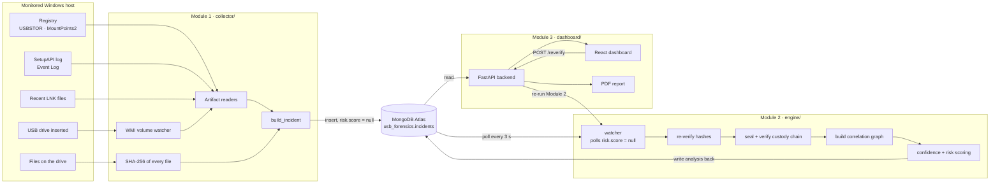
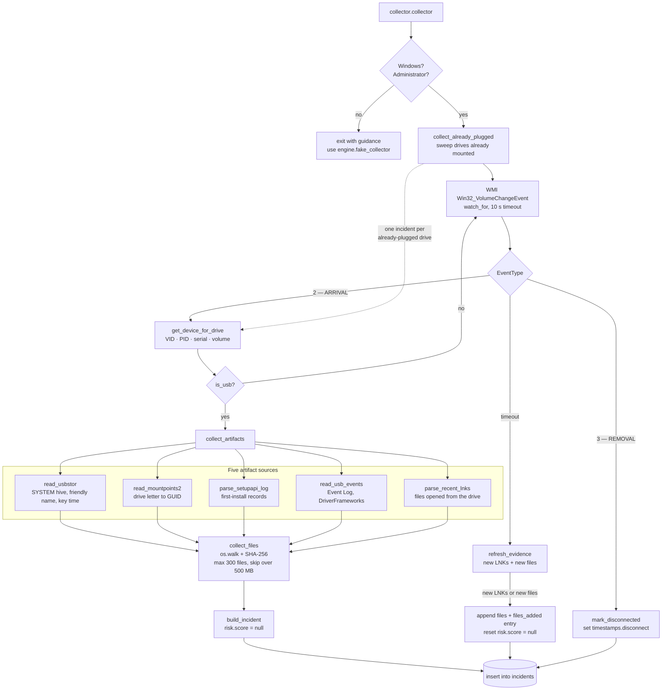
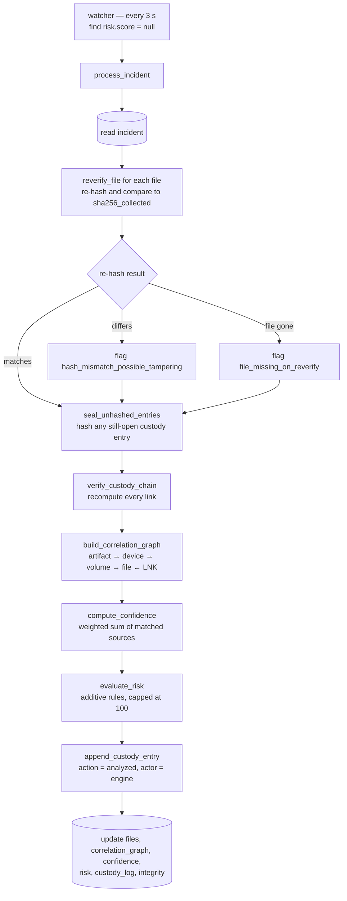
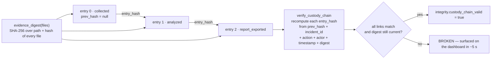
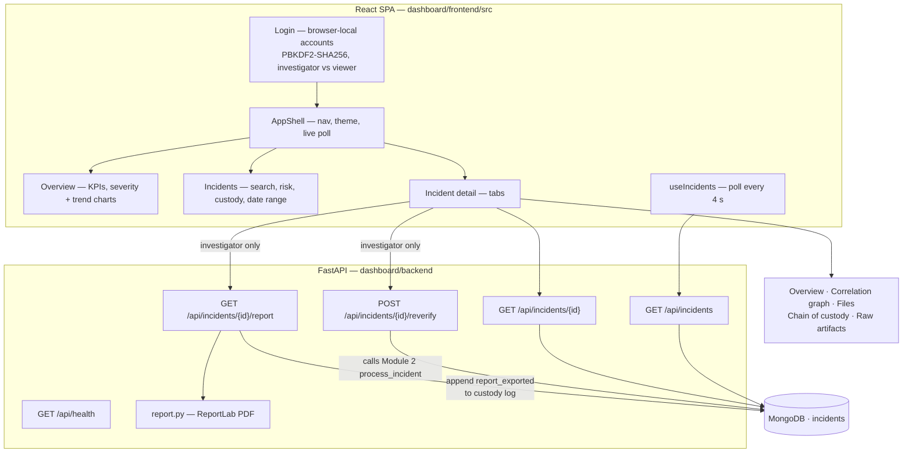
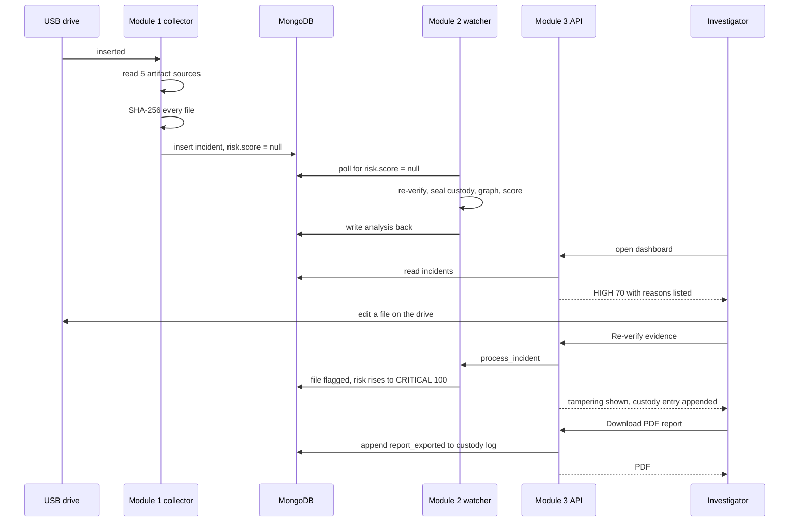

# Architecture & Related Work

USB Forensics & Intelligent Incident Logger — Information Security Lab mini project
Guide: Dr Raghavendra Ganiga

| Module | Folder | Owner |
|---|---|---|
| 1 — USB Monitoring & Artifact Collector | `collector/` | Aarya Agarwal (240911190) |
| 2 — Forensic Analysis & Integrity Engine | `engine/` | Mahira Srivastava (240911416) |
| 3 — Investigator Dashboard & Reporting | `dashboard/` | Arnav Sahu (240911402) |

The three modules never call each other directly. They are joined by **one MongoDB
collection, `usb_forensics.incidents`**, and by one document shape
(`shared/sample_incident.json`). That is the whole integration contract: Module 1 writes
a document with `risk.score = null`, Module 2 notices it and fills in the analysis,
Module 3 reads it.

---

## 1. Whole-system architecture

**Why a shared database instead of direct calls.** The collector runs on the Windows
machine being monitored; the engine and dashboard can run anywhere. A queue-free,
poll-based hand-off through MongoDB means any module can be restarted, demoed or
graded on its own, and a crashed collector never blocks analysis of incidents already
recorded.

---

## 2. Module 1 — USB Monitoring & Artifact Collector

Windows-only, run as Administrator. Entry point: `python -m collector.collector`.

**Design decisions worth defending in the viva**

- **Five sources, not one.** A single registry key can be stale or wiped; five
  independent traces agreeing is what Module 2 later turns into a confidence score.
- **Append-only evidence: hash each file once, but keep looking.** The 10-second refresh
  loop re-walks the drive and hashes *only paths not already collected*, appending them and
  recording a `files_added` custody entry. A hash already recorded is **never** recomputed,
  because silently re-hashing would overwrite the very evidence the custody chain protects.
  So evidence can grow while the drive is plugged in, but it can never be quietly rewritten
  — see the custody model in Module 2.
- **Bounded collection.** `MAX_FILES = 300` and `MAX_FILE_BYTES = 500 MB`, with
  `System Volume Information` and `$RECYCLE.BIN` skipped, so a large drive cannot stall
  the collector.

---

## 3. Module 2 — Forensic Analysis & Integrity Engine

Platform-independent. Entry point: `python -m engine.watcher`.

### Chain of custody — the integrity mechanism

Each entry stores a hash of the entry before it, so the log is append-only in effect:
editing any earlier entry, or any recorded file hash, breaks every link after it.

### Scoring (exact values from `engine/scoring.py`)

**Evidence confidence** — how many independent sources corroborate the incident:

| Source matched | Weight |
|---|---|
| `usbstor` | 25 |
| `lnk_files` | 25 |
| `setupapi` | 20 |
| `eventlog` | 20 |
| `mountpoints2` | 10 |

Level: `HIGH ≥ 70`, `MEDIUM ≥ 40`, else `LOW`.

**Risk** — additive rules, each one recorded as a human-readable justification string:

| Rule | Points |
|---|---|
| Hash mismatch on re-verification | +30 |
| Unauthorized device — serial not in `APPROVED_SERIALS` | +25 |
| Executable transferred — `.exe .bat .ps1 .dll .vbs` | +25 |
| Sensitive filename — `confidential, password, salary, payroll, secret` | +20 |
| Large transfer over 100 MB | +15 |
| File missing on re-verification | +10 |

Total capped at 100. Level: `CRITICAL ≥ 80`, `HIGH ≥ 55`, `MEDIUM ≥ 25`, else `LOW`.
Confidence and risk are deliberately **separate axes** — *how sure we are* is a
different question from *how bad it is*.

---

## 4. Module 3 — Investigator Dashboard & Reporting

FastAPI backend + React (Vite) frontend.

**Notes**

- The two investigator-only actions are exactly the two that **write to the chain of
  custody**: `/reverify` appends an `analyzed` entry, `/report` appends a
  `report_exported` entry. Everything read-only is shared with the viewer role.
- Sign-in is a browser-side gate (accounts in `localStorage`, passwords as PBKDF2-SHA256
  over a random salt). The API itself is unauthenticated, so this governs what the
  dashboard offers, not what the server will answer. It is a lab-demo role switch, not
  access control.
- The Files tab states when collection began and that later files are appended with a
  `files_added` custody entry, so the Module 1 design decision is visible to the
  investigator rather than being a surprise.

---

## 5. End-to-end sequence

---

## 6. Comparison with prior work

The table compares what each cited work covers against what this project does. Entries
are about *scope*, not quality — the papers below are foundational research, and this is
an undergraduate integration project built on top of what they established.

| Prior work | What it contributes | What it does not cover | Here |
|---|---|---|---|
| Carvey & Altheide, *Tracking USB storage*, Digital Investigation 2(2):94–100, 2005 | First peer-reviewed account of the Windows artifacts a USB device leaves; established USBSTOR and MountPoints2 as the places to look (Windows XP era) | Manual analysis; no automation, no risk judgement, no integrity proof | Reads the same registry sources, but automatically and on insertion |
| Shaver, *Exposing Vital Forensic Artifacts of USB Devices in the Windows 10 Registry*, NPS thesis, 2015 | Maps which Windows 10 registry hives change on insertion; identifies last insert/remove timestamps | Registry only; a post-hoc examiner workflow | Adds SetupAPI, Event Log and LNK on top of the registry sources |
| Arshad, Iqbal & Abbas, *USB Storage Device Forensics for Windows 10*, J. Forensic Sciences, 2018 | Captures registry + event log before, during and after insertion; compares Windows 8 and 10 | Describes artifacts; does not correlate them into one case object or score them | Correlates the five sources into a single incident with a confidence score |
| Ćosić & Bača, *A Framework to (Im)Prove Chain of Custody in Digital Investigation Process* (DEMF), CECIIS, 2010 | Chain of custody built on a SHA-2 fingerprint of the evidence plus biometrics and a trusted timestamp | Framework proposal; not tied to a live acquisition source | Implements a hash-linked custody log that seals each entry with the previous one |
| Guidance Software, *Systems… for forensic monitoring*, US Patent 9,507,936 (2016) | Nearest prior art overall: a dashboard of risk indicators across forensic categories, drill-down reports for USB storage, triggered automatically on an incident | Three-level verdict (pass/warn/fail), not an explainable per-rule score; a patent filing, not validated or reproducible research; no published custody-chain design | Open implementation with per-rule justification and a hash-linked custody log |
| Lone & Mir, *Forensic-chain: Blockchain based digital forensics chain of custody*, Digital Investigation 28:44–55, 2019 | Tamper-evident custody using a permissioned blockchain (Hyperledger Composer PoC) | Needs blockchain infrastructure; concerned with custody, not with detecting the incident | Same tamper-evidence goal with a hash chain inside the incident document — no extra infrastructure |

### What this project adds

To be precise about the claim: **none of the individual techniques here are new.** Hash
chains, registry artifact parsing and rule-based scoring are all established. What this
project contributes is the **integration** — the cited works each solve one slice, and
nothing in the list above does the whole path from *device inserted* to *explainable,
integrity-checked incident on a screen*:

1. **One incident object spanning all five artifact sources.** The literature documents
   the sources individually; here they are correlated into a single case document with a
   node-and-edge graph linking artifact → device → volume → file ← LNK.
2. **Confidence separated from risk.** Corroboration strength (how many independent
   sources agree) is scored apart from severity. The surveyed USB papers report artifacts
   without quantifying either.
3. **A custody chain over *live, automatically collected* evidence.** DEMF and
   Forensic-Chain assume evidence already in an examiner's hands. Here the chain is
   sealed at collection time by the collector itself, and every later action — engine
   re-analysis, PDF export — appends a linked entry.
4. **Tamper evidence demonstrable in seconds, with no blockchain.** Editing a file on
   the drive, or editing the custody log directly in the database, is caught on the next
   re-verification and surfaced on the dashboard. Forensic-Chain achieves this with a
   permissioned ledger; a per-incident hash chain gets the same tamper-evidence for this
   threat model at zero infrastructure cost.
5. **Explainable scoring.** Every risk score ships with the exact rules that fired
   (`(+25) Executable file transferred: …`), so the number is never a black box.
6. **End-to-end automation.** Insertion to scored incident on screen takes a few seconds
   with no analyst action — the surveyed work is post-hoc and manual.
7. **A third verification outcome: *unreachable*.** Classical hash verification has two
   outcomes — match or mismatch — because an examiner re-hashes evidence they are holding.
   A system that re-verifies *continuously* meets a third case constantly: the drive is
   unplugged, or the analysis runs on a different host from the collection. Folding that
   into "mismatch" fabricates tampering findings. We measured this on our own data: one
   benign drive was rated CRITICAL 100 with 300 invented findings purely because the
   dashboard host could not see drive `F:`. The engine now separates `evidence_unreachable`
   from `file_missing_on_reverify`, scores it zero, reports it once per incident, and the
   dashboard shows *drive offline* rather than *missing* — the same incident then scores
   MEDIUM 40 with 3 real findings. This distinction is a direct consequence of automating
   re-verification, which is why the post-hoc literature does not have to confront it.

### Honest limitations

- **Rule-based, not learned.** Risk uses fixed additive weights chosen by hand; there is
  no training data and no claim of statistical validity.
- **Hash chain ≠ distributed ledger.** It detects tampering by anyone without write
  access to the whole chain, but an attacker with full database write access could
  recompute every entry. Forensic-Chain's threat model is genuinely stronger.
- **Windows-only collection**, and the collector needs Administrator rights to read
  event logs and SetupAPI.
- **Append-only file collection.** Each file is hashed once and never re-hashed, so a file
  *replaced* on the drive keeps its original recorded hash and is caught by re-verification
  as a mismatch rather than by re-collection. Additions are picked up only while the drive
  stays plugged in and the collector is running, and stop at the 300-file cap.
- **The custody chain's evidence binding is per-entry.** Each entry seals the evidence as it
  stood when written and the newest entry must match the files as they are now. An attacker
  able to append both a file and a matching entry could therefore grow the manifest; the
  design assumes no write access to the database, which is the same assumption the whole
  chain already rests on.
- **The dashboard sign-in is not access control** — the API is unauthenticated.
- **Not validated against a court-admissibility standard**; this is a lab project, not a
  forensically certified tool.

---

## 7. References

1. H. Carvey and C. Altheide, "Tracking USB storage: Analysis of Windows artifacts
   generated by USB storage devices," *Digital Investigation*, vol. 2, no. 2,
   pp. 94–100, June 2005.
2. J. Shaver, "Exposing Vital Forensic Artifacts of USB Devices in the Windows 10
   Registry," M.S. thesis, Naval Postgraduate School, 2015.
3. A. Arshad, W. Iqbal and H. Abbas, "USB Storage Device Forensics for Windows 10,"
   *Journal of Forensic Sciences*, 2018, doi:10.1111/1556-4029.13596.
4. J. Ćosić and M. Bača, "A Framework to (Im)Prove Chain of Custody in Digital
   Investigation Process," *CECIIS*, 2010.
5. Guidance Software, Inc., "Systems, methods, apparatuses, and computer program products
   for forensic monitoring," U.S. Patent 9,507,936, Nov. 2016.
6. A. H. Lone and R. N. Mir, "Forensic-chain: Blockchain based digital forensics chain
   of custody with PoC in Hyperledger Composer," *Digital Investigation*, vol. 28,
   pp. 44–55, 2019.
